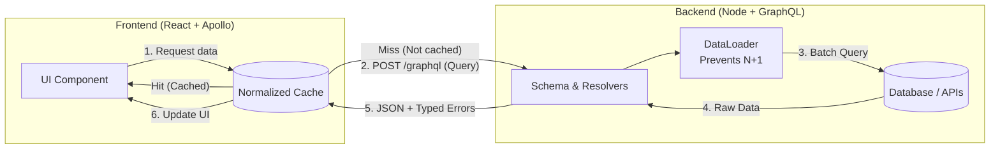

# Tech Stack

- [GraphQL](https://graphql.org/)
- [React](https://react.dev/)
- [NodeJs](https://nodejs.org/)
- [TypeScript](https://www.typescriptlang.org/)

- [Bun](https://bun.com/)
- [Biome](https://biomejs.dev/)

---



---

# Server

- init

```bash
bun init -y
```

- add dependencies

```bash
bun add graphql @apollo/server
```

- run

```bash
node src/main.ts
```

- using 'script'

```bash
bun run dev
```

---

# Client

- init

```bash
bunx create-vite
```

- then, select the next one:

  > - Project name: `.`
  > - Select a framework: `React`
  > - Select a variant: `TypeScript + React Compiler`
  > - Which linter to use?: `ESLint` - **then, I'll change by Biome**
  > - Install with bun and start now?: `Yes`

## Change `ESLint` by `Biome`

```bash
bun remove eslint @eslint/js eslint-plugin-react-hooks eslint-plugin-react-refresh globals typescript-eslint
bun add -d --exact @biomejs/biome
bunx biome init
```

## Apollo Client

- dependencies

```bash
bun add graphql @apollo/client
```

- run `script`

```bash
bun run dev
```
