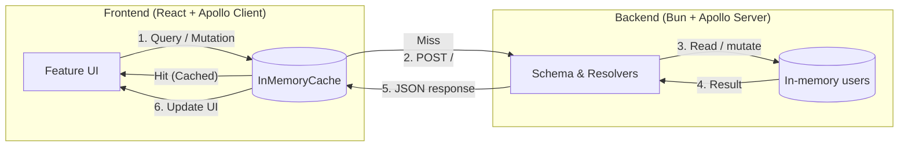

# React GraphQL TS

Full-stack GraphQL example with a feature-based React client (Apollo Client) and an Apollo Server backend running on Bun.

## Tech Stack

- [GraphQL](https://graphql.org/)
- [React](https://react.dev/)
- [Apollo Client](https://www.apollographql.com/docs/react/)
- [Apollo Server](https://www.apollographql.com/docs/apollo-server/)
- [TypeScript](https://www.typescriptlang.org/)
- [Vite](https://vite.dev/)
- [Bun](https://bun.com/)
- [Biome](https://biomejs.dev/)

## Architecture



The client stores query results in Apollo's normalized cache. After `addUser`, the mutation updates the cached `getUsers` list with `cache.updateQuery`, so the list refreshes without an extra request.

## Project Structure

```text
.
├── client/
│   ├── .env.example
│   ├── biome.json
│   └── src/
│       ├── features/
│       │   └── user-management/
│       │       ├── components/
│       │       │   ├── Add/
│       │       │   ├── List/
│       │       │   └── ListById/
│       │       ├── graphql/
│       │       │   ├── mutation.ts
│       │       │   └── query.ts
│       │       ├── types/
│       │       │   └── index.ts
│       │       ├── index.tsx
│       │       └── styles.module.css
│       ├── shared/
│       │   └── styles/
│       │       └── elements.css
│       ├── main.css
│       └── main.tsx
└── server/
    ├── biome.json
    ├── data/
    │   └── db.ts
    └── src/
        └── main.ts
```

## Why Feature-Based?

The client is organized by business capability instead of by technical layer. Everything needed for user management lives in the `user-management` feature slice:

- `components/`: UI for adding, listing, and finding users.
- `graphql/`: queries and mutations used by the feature.
- `types/`: feature-level TypeScript types.
- `styles.module.css`: styles scoped to the feature.
- `index.tsx`: the feature's public entry point.

Cross-feature concerns live in `shared/`. This is a lightweight **vertical slice / package-by-feature** structure inspired by [Feature-Sliced Design (FSD)](https://feature-sliced.design/). It applies the `features` and `shared` layers only; it is not a full FSD setup (there are no `app`, `pages`, `widgets`, or `entities` layers).

This approach was chosen because it keeps related code together, makes changes local to one feature, avoids navigation across technical folders, and gives the project a clear path to grow. If the application expands, the same structure can evolve toward full FSD by introducing the remaining layers.

## Requirements

- [Bun](https://bun.com/) 1.2 or newer

Node.js is not required to run the server; Bun is the runtime.

## Getting Started

### Server

```bash
cd server
bun install
bun run dev
```

The GraphQL endpoint is available at `http://localhost:4000/`.

### Client

```bash
cd client
bun install
cp .env.example .env
bun run dev
```

The Vite development server runs at `http://localhost:5173` by default. If `VITE_GRAPHQL_URL` is not defined, the client falls back to `http://localhost:4000`.

## Environment Variables

Create `client/.env` from `client/.env.example`:

```bash
cp client/.env.example client/.env
```

| Variable            | Default                 | Description                          |
| ------------------- | ----------------------- | ------------------------------------ |
| `VITE_GRAPHQL_URL`  | `http://localhost:4000` | GraphQL endpoint used by Apollo Client |

The local `.env` file is ignored by Git; only `.env.example` is versioned.

## Scripts

### Client

| Command           | Description                           |
| ----------------- | ------------------------------------- |
| `bun run dev`     | Start the Vite development server     |
| `bun run build`   | Type-check and build for production   |
| `bun run preview` | Preview the production build          |
| `bun run lint`    | Check lint and formatting with Biome  |
| `bun run format`  | Format files with Biome               |
| `bun run check`   | Apply Biome lint and formatting fixes |

### Server

| Command             | Description                           |
| ------------------- | ------------------------------------- |
| `bun run dev`       | Start Apollo Server in watch mode     |
| `bun run start`     | Start Apollo Server                   |
| `bun run lint`      | Check lint and formatting with Biome  |
| `bun run format`    | Format files with Biome               |
| `bun run check`     | Apply Biome lint and formatting fixes |
| `bun run typecheck` | Type-check with TypeScript            |

## Styling

- `src/main.css`: design tokens and global reset.
- `src/shared/styles/elements.css`: shared base styles for HTML elements and layout.
- `src/features/**/*.module.css`: component- and feature-scoped CSS Modules.

## GraphQL API

```graphql
type Query {
  getUsers: [User]
  getUserById(id: ID!): User
}

type Mutation {
  addUser(name: String!, age: Int!, weight: Float, isMarried: Boolean): User
}

type User {
  id: ID
  name: String
  age: Int
  weight: Float
  isMarried: Boolean
}
```

Client operations live in `client/src/features/user-management/graphql/`:

- `query.ts`: `GET_USERS` and `GET_USER_BY_ID`.
- `mutation.ts`: `ADD_USER`.

Server data lives in `server/data/db.ts` and is stored in memory. New users are appended to the array and are lost when the server restarts.
