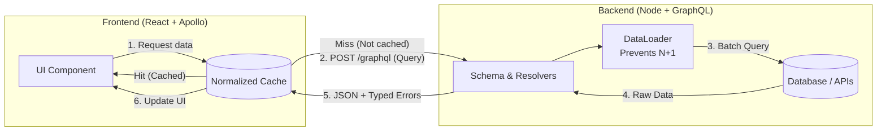

# React GraphQL TS

Full-stack GraphQL example with React + Apollo Client on the client and Apollo Server on the server.

## Tech Stack

- [GraphQL](https://graphql.org/)
- [React](https://react.dev/)
- [Node.js](https://nodejs.org/)
- [TypeScript](https://www.typescriptlang.org/)
- [Bun](https://bun.com/)
- [Biome](https://biomejs.dev/)

## Architecture



## Project Structure

```text
.
├── client/   React + Vite + Apollo Client, linted and formatted with Biome
└── server/   Apollo Server running on Bun
```

## Requirements

- [Bun](https://bun.com/) 1.2 or newer

## Getting Started

### Server

```bash
cd server
bun install
bun run dev
```

The GraphQL endpoint is available at `http://localhost:4000/`.

### Client

```bash
cd client
bun install
bun run dev
```

The client expects the server at `http://localhost:4000`.

## Scripts

### Client

| Command          | Description                              |
| ---------------- | ---------------------------------------- |
| `bun run dev`    | Start the Vite development server        |
| `bun run build`  | Type-check and build for production      |
| `bun run preview`| Preview the production build             |
| `bun run lint`   | Check lint and formatting with Biome     |
| `bun run format` | Format files with Biome                  |
| `bun run check`  | Apply Biome lint and formatting fixes    |

### Server

| Command              | Description                          |
| -------------------- | ------------------------------------ |
| `bun run dev`        | Start Apollo Server in watch mode    |
| `bun run start`      | Start Apollo Server                  |
| `bun run typecheck`  | Type-check with TypeScript           |

## GraphQL API

```graphql
type Query {
  getUsers: [User]
  getUserById(id: ID!): User
}

type Mutation {
  addUser(name: String!, age: Int!, weight: Float, isMarried: Boolean): User
}

type User {
  id: ID
  name: String
  age: Int
  weight: Float
  isMarried: Boolean
}
```
